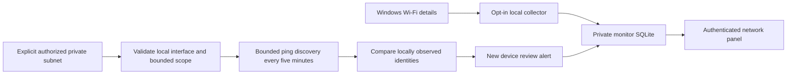
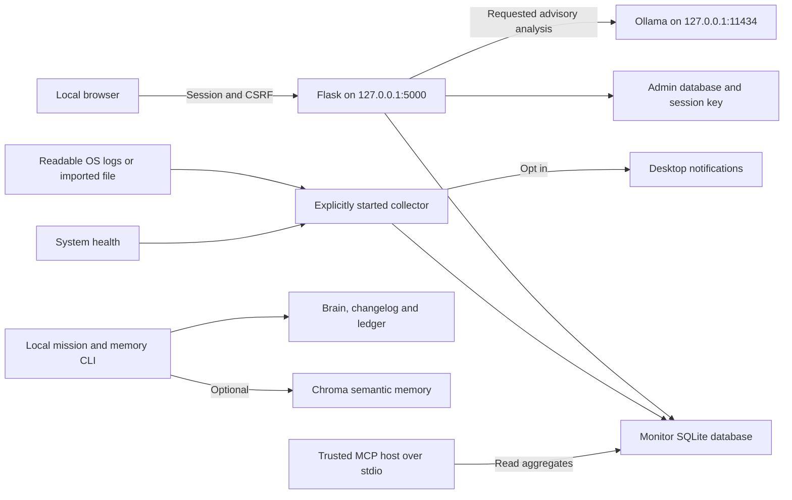
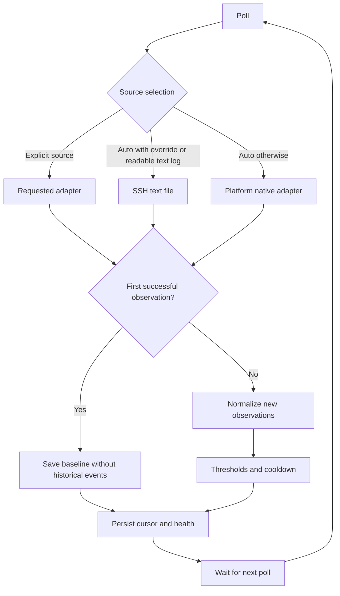
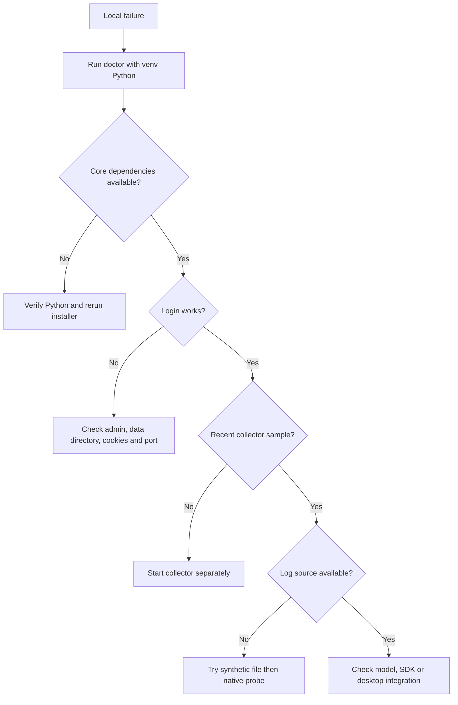

# SecuriGotchi — local cybersecurity companion

**Navigation:** [Install](#cross-platform-core-installer-python-311) · [Windows setup](#windows-quick-start-powershell) · [Platform matrix](#platform-matrix) · [Architecture](#data-flow) · [Local tests](#isolated-local-tests) · [Synthetic alerts](#synthetic-alert-exercise) · [Storage](#configuration-and-storage) · [API](#http-reference) · [Troubleshooting](#troubleshooting-decision-path)

## Wi-Fi health and local device discovery (Windows)

Both are opt-in. Use the same `SECURIGOTCHI_DATA_DIR` as the dashboard. For the local test installation this is `.securigotchi/interactive` under the checkout.

```powershell
$env:SECURIGOTCHI_DATA_DIR = Join-Path (Get-Location) '.securigotchi/interactive'
# Passive Wi-Fi health, every collector poll:
.\.venv\Scripts\python.exe gotchi_monitor.py watch --network --interval 60
# Or, after stopping the first collector, add authorized local discovery:
.\.venv\Scripts\python.exe gotchi_monitor.py watch --network --discover-network 192.168.0.0/24 --interval 60
```

Replace the example subnet with your authorized directly connected network. Discovery only accepts RFC1918 IPv4 /24–/30 ranges present on an active local interface. It sends one ping per host, at most 254 targets with 16 workers and bounded timeouts, every five minutes. There are no port scans, remote commands, packet capture, DNS/vendor lookups, or router changes. Authorization is your responsibility; a private address alone does not confer it. Never run two watch processes against the same data directory.

For a single interactive check, run `check-network.cmd` from a regular Windows terminal and enter your subnet. It uses the isolated local test data directory and leaves no background process. In restricted app runtimes, Windows may deny netsh Wi-Fi details, neighbor-table reads or the ping driver entirely; use a normal local terminal rather than elevating or changing firewall settings. SSID/radio details may also depend on Windows location permissions. Non-English netsh output and multiple Wi-Fi radios are not fully supported; unknown fields stay unavailable.

| Monitoring | Data / behavior |
| --- | --- |
| Wi-Fi health | Connection state, SSID, signal percentage, authentication, interface/IP/subnet where available |
| Alerts | Disconnect/reconnect or SSID changes: warning; signal below 30%: warning; Open/Shared/WEP authentication: high |
| Device discovery | Responding IPv4 addresses; MAC if readable from neighbor table; sampling time and scope |
| First successful sample | Establishes baseline without new-device alerts |
| Later new identity | Warning to review, never an automatic intruder classification |
| Identity | MAC where available, otherwise IP; DHCP/randomized MACs can produce apparent new devices |
| Persistence | Monitor SQLite network state and devices; last-seen identities retained 30 days; app data backup contains SSIDs/IPs/MACs |
| API | Authenticated GET `/api/network`, stored results only; no browser-triggered scans |
| Staleness | Samples older than 180 seconds are labelled stale; discovery timestamp is separate and can be five minutes old |

Only ping responders appear in a sample. Sleeping/firewalled clients and isolated wireless clients may be missed; this is not a complete router inventory. Neighbor entries alone are not proof of presence. An empty successful sample is not proof the network is empty; denied probing is explicitly unavailable. Historical discovery identities persist only for detecting newly observed devices, not a device trust list. Network telemetry is shown to the local authenticated administrator; it is not added to AI prompts or MCP aggregates. Existing aggregate status/mood may reflect network alerts.



SecuriGotchi is a local-first gamified Python security companion for Ubuntu, WSL, and Raspberry Pi. It provides mission XP, a tamper-evident SHA-256 activity log, optional GPG signatures, optional ChromaDB semantic memory, local Ollama chat, CLI plugins, and a localhost dashboard.

> **Security notice:** Phase 2 adds **one local administrator account**, created only from the terminal, and protected dashboard sessions. There is no public sign-up, device enrollment, multi-user permissions, or secure remote access. Plugin execution remains disabled through HTTP. Do not expose the Flask dashboard to the public internet.

## Cross-platform core installer (Python 3.11+)

`python install.py` works on Windows, macOS, Linux and Raspberry Pi OS with suitable Python availability. On Windows, use `py -3.11 install.py` or newer. Run the created `.venv/Scripts/python.exe` on Windows and `.venv/bin/python` on Unix. The portable base includes Flask plus optional `psutil` system health; large AI packages are still optional (`python install.py --with-ai`). No elevated privileges are required. The portable dashboard binds to `127.0.0.1`; do not expose it to the internet.

**Coverage:** Windows/macOS can run the local dashboard, persistent health samples and authentication. Native Windows Security, macOS SSH unified-log and Linux journald adapters exist on a best-effort basis. Linux and Raspberry Pi OS can additionally use text-based SSH log ingestion, systemd user services and opt-in notify-send notifications. Windows native users should use `install.py` instead of the shell installer.

## Install (Python 3.11+)

```bash
git clone https://github.com/CptNope/SecuriGotchi.git
cd SecuriGotchi
bash secgotchi_install.sh
.venv/bin/python gotchi_auth.py init-admin
.venv/bin/python gotchi_webui.py
```

Open **http://127.0.0.1:5000** on the same computer and sign in as `admin` with your newly created password. First-run registration happens in the terminal and is closed after the administrator is created. The signing key and password verifier are stored in the OS-specific private app data directory (see the table below), not in the repository. For custom storage set `SECURIGOTCHI_DATA_DIR` to a user-owned, private directory before running setup or the dashboard.

**Important:** Keep a backup of this directory. No password reset UI or remote login is provided. The installer creates a Python virtual environment and installs the lightweight Flask core. It does not perform sudo changes or system-wide pip installs.

For optional semantic memory:

```bash
bash secgotchi_install.sh --with-ai
.venv/bin/python gotchi_memory.py "Completed authorized SSH audit" 25
.venv/bin/python gotchi_query.py "SSH audit" --page 1 --page-size 3
```

The first vector query may download an embedding model and can require substantial RAM. Ollama is a separate optional local service. Pull the model configured in `gotchi_ai_config.json`, start Ollama on loopback, then run:

```bash
.venv/bin/python gotchi_agent.py
```

## Local SSH threat snapshot

The signed-in dashboard now displays counts of failed SSH logins, accepted logins, invalid-user events, and unique failing source IPs. The backend reads **only the last 1 MiB** of an accessible `/var/log/auth.log` or `/var/log/secure`. No sudo escalation or shell commands are used for log reading. The snapshot is sampled, not real-time detection or a complete intrusion history.

If neither default log is readable, set `SECURIGOTCHI_AUTH_LOG` to a local log file you are authorized to read. The dashboard shows an unavailable state rather than requiring elevated permissions. The browser receives summary counts, not raw log lines.

## Phase 3: Opt-in local monitoring

The continuous monitor is **not** started automatically by the web server. Run it in another terminal or supervised OS service:

```bash
.venv/bin/python gotchi_monitor.py once
.venv/bin/python gotchi_monitor.py watch --interval 60
.venv/bin/python gotchi_monitor.py status
```

The collector reads appended lines from a readable SSH authentication log and samples disk, memory and load. The **first poll starts at the current end of the log**, to avoid treating historical entries as fresh attacks. New log events and alert episodes are saved in a private SQLite database under `SECURIGOTCHI_DATA_DIR`. It keeps events for 7 days and alerts for 30 days. It never runs scans, reads private usernames into the database, or changes firewall rules.

Rules: five SSH failures from the same IP within five minutes trigger **high** severity (ten trigger **critical**); disk/memory thresholds of 80/90/97 percent trigger warning/high/critical respectively. Alert cooldown: 15 minutes per fingerprint, with immediate severity escalation.

The dashboard polls `/api/monitor` every 30 seconds and shows the Gotchi's derived **calm, watchful, alert, critical, or sleeping** mood. It does not award XP for attacks or pretend that monitoring is active when the collector is stale. The system is **not** a general IDS: no email/push notifications, guaranteed delivery, or malware classification exists yet. Log rotations and large spikes can lose events; skipped bytes are reported, and the file-offset model may need deeper handling on unusual filesystems.

## Phase 4: Local desktop notifications and systemd user service

**Notifications are opt-in and local only.** On a Linux graphical session, install `notify-send` (Debian/Ubuntu: `sudo apt install libnotify-bin`) and test it:

```bash
.venv/bin/python gotchi_notifications.py test
.venv/bin/python gotchi_monitor.py watch --interval 60 --notify --notify-level high
```

The notifier only displays short alert titles and severity (not IP addresses, usernames, raw logs, or AI-generated commands). It requires a working desktop D-Bus session; **headless Raspberry Pi and most WSL sessions should run without `--notify`**. It processes new events only after explicit opt-in, retries when the desktop notification broker fails, and maintains a private SQLite cursor. Desktop broker acceptance does not guarantee the person saw the notification. A crash after delivery but before cursor persistence can repeat it.

To generate a **systemd user service** for the same checkout:

```bash
.venv/bin/python gotchi_service.py print
.venv/bin/python gotchi_service.py install
systemctl --user daemon-reload
systemctl --user enable --now securigotchi-monitor.service
systemctl --user status securigotchi-monitor.service
journalctl --user -u securigotchi-monitor.service -n 50
```

The generator writes a unit but **does not start or enable** it. Add `--notify` to the `gotchi_service.py install` command only for a logged-in graphical user session. Do not run a second manual `watch` concurrently; the collector uses a nonblocking Unix/Windows file lock. The service uses the default data directory `~/.local/share/securigotchi`; custom storage needs manual unit configuration. Avoid enabling systemd lingering to force user-session notifications on headless devices.

Service unit supervision does not guarantee log permissions, desktop D-Bus delivery, or cross-platform compatibility; test on the actual Ubuntu/WSL/Raspberry Pi system. Notifications do not depend on Ollama and never execute response actions.

## Local-only tools

```bash
.venv/bin/python gotchi_mission.py list
.venv/bin/python gotchi_mission.py run 2
.venv/bin/python plugin_runner.py
```

Only test systems and networks you own or have permission to inspect. Missions require explicit confirmation and no longer run through a shell. **Legacy plugins still need independent review**: many use shell commands and some are interactive. Do not run untrusted plugins or allow remote users to invoke them.

## Verify the activity ledger

```bash
.venv/bin/python gotchi_chain.py
```

Ledger blocks include the SHA-256 hash of their contents plus a previous-hash reference. Every block, including genesis, is checked. When GPG signing succeeds, the complete ledger is detached-signed. Without an available signing key the ledger is marked unsigned, even if its hashes are internally consistent. Hash chains are not immutable, decentralized blockchains. Runtime state is not encrypted at rest.

## Development

```bash
.venv/bin/python -m compileall -q gotchi_agent.py gotchi_chain.py gotchi_memory.py gotchi_mission.py gotchi_query.py gotchi_vector.py gotchi_webui.py plugin_manager.py plugin_runner.py plugins
.venv/bin/python -m unittest discover -s tests -v
```

GitHub Actions runs core syntax/tests on supported Python versions. Optional AI dependencies are not included in the core CI run.

## Further improvements

1. Move all runtime data to a dedicated directory; implement atomic multi-file transactions, locking, migration and backups.
2. Extend the local single-admin login with OS-independent auth support, secure reset/recovery, roles, hardware-device enrollment, stronger rate limiting, and a remote-access threat model.
3. Rewrite legacy plugins as permission-scoped, sandboxed, argument-validated and timeout-limited subprocesses.
4. Add dependency lockfiles, broader CI, tested Chroma migrations, signed manifest verification and Ollama integration tests.
5. Improve Raspberry Pi touchscreen interface, journald ingestion, severity/rule logic, device-local notification support and continuously collected metrics.

© Jeremy Anderson · [Jeremy Anderson Tech](https://jeremyanderson.tech)

## Phase 7: AI and MCP

A 24-hour aggregated failure chart is available in the signed-in dashboard. Install optional MCP dependencies with `.venv/bin/python -m pip install -r requirements-mcp.txt`, then configure a trusted local client to run `gotchi_mcp.py` with `SECURIGOTCHI_MCP_ENABLE=1` as described in [the MCP guide](docs/mcp.md). For opt-in local, advisory-only Ollama explanations use `.venv/bin/python gotchi_explain.py --model llama3`. No web-triggered model execution or remote cloud AI telemetry is enabled.

## Phase 8: Local AI Operations Center

The authenticated dashboard now contains optional local Ollama diagnostics, discovery of installed models and an explicitly requested read-only incident explanation. The collector must be running and Ollama must be listening on `127.0.0.1:11434`. Aggregate, redacted monitoring information is sent only to the selected local model; no cloud provider is configured. The backend enforces CSRF, a single in-flight analysis, model validation, and localhost-only Ollama requests. Reports are advisory, not evidence of compromise. **Do not expose Flask or Ollama on the public internet.**

## Phase 9: Installation diagnostics

Run `python gotchi_doctor.py` for a non-destructive Python/dependency, admin,
session-key, collector and optional integration health report. Use
`python gotchi_doctor.py --json` for structured output. Additional bounded
read-only OS-log and local Ollama probes are **opt-in** with
`--probe-logs --probe-ollama`. It does not perform installation or
auto-remediation. See [Setup Doctor guide](docs/setup-doctor.md).


## ClockworkPi uConsole CM4

The core dashboard and monitoring collector run on a supported 64-bit Linux
image for the **ClockworkPi uConsole with Raspberry Pi Compute Module 4**.
The compact dashboard adapts to the handheld's 1280×720 landscape screen and
a rotated/narrow viewport. No hardware firmware or kernel is modified.

On the uConsole, run:

```bash
python3 --version  # Python 3.11+ required
python3 install.py
.venv/bin/python gotchi_doctor.py --device uconsole-cm4
.venv/bin/python gotchi_auth.py init-admin
.venv/bin/python gotchi_webui.py
```

In a separate terminal, start the local monitor using
`.venv/bin/python gotchi_monitor.py watch --interval 60 --source auto`.
The explicit `--device` flag selects the uConsole profile because the CM4
board identifier alone cannot prove which enclosure it is installed in.
Optional ChromaDB and large local AI models are **not** installed by default,
which helps on limited ARM storage, RAM and battery power. For troubleshooting
and display tips see [uConsole CM4 setup](docs/uconsole-cm4.md).
## Local setup, architecture and debugging reference

### Windows quick start (PowerShell)

```powershell
py --list
py -3.12 install.py
.\.venv\Scripts\python.exe gotchi_doctor.py
.\.venv\Scripts\python.exe gotchi_auth.py init-admin
.\.venv\Scripts\python.exe gotchi_webui.py
```

Use any installed Python 3.11+ in place of 3.12. Administrator passwords must be 14–256 characters. Open http://127.0.0.1:5000, username `admin`. Start the collector in another terminal with the same data directory. Ctrl+C stops foreground processes. No venv activation is required.

### Platform matrix

| Capability | Windows | macOS | Linux / Pi / WSL |
| --- | --- | --- | --- |
| Dashboard, local admin, SQLite monitoring | Yes | Yes | Yes |
| Disk/memory health | Yes; load average may be absent | Yes | Yes |
| Imported SSH text file | Yes | Yes | Yes |
| Native collector | `wevtutil`, Security IDs 4624/4625 | Unified log, `sshd`, rolling five-minute window | `journalctl`, `_COMM=sshd` |
| Default SSH text logs | None | None | `/var/log/auth.log`, `/var/log/secure` |
| Desktop notifications | Not implemented | Not implemented | Optional notify-send and graphical D-Bus |
| Service generator | Not implemented | Not implemented | systemd user service |

Native adapters depend on OS audit policy, executable availability and read permissions. Windows events are general logons, **not exclusively SSH**; interpret SSH-labelled alerts accordingly. WSL observes its Linux environment, not automatically Windows host events. Native parser fixtures do not prove actual-host integration.

The threat snapshot is a separate text-only reader. It can be unavailable while the persistent native collector works. Use `gotchi_monitor.py status` or `/api/monitor` to assess the collector.

### Data flow





### Collector semantics

| Setting | Behavior |
| --- | --- |
| Interval | Default 60 seconds; range 10–3600 |
| Source | `--source auto`, `file`, `journal`, `windows`, `macos` |
| Initial observation | Establishes baseline without historical event alerts |
| Failure thresholds | Five same-IP failures in five minutes: high; ten: critical |
| Disk/memory thresholds | 80% warning; 90% high; 97% critical |
| Cooldown | 15 minutes per fingerprint; immediate severity escalation |
| Retention | Events/health/native deduplication seven days; alerts 30 days; pruned during polls |
| Freshness | Last poll within 180 seconds means running; otherwise stale |
| Mood | Sleeping if inactive; otherwise highest alert severity in last hour |
| Display | 24-hour event counts; at most 12 recent alerts; 24-hour trend chart |

Timestamps are ingestion times, not original log timestamps. A recent `once` poll can temporarily report running without a watch process. Intervals above 180 seconds can appear stale between polls. Windows queries at most 250 matching events, journald uses a bounded query, and macOS reads a rolling five-minute window. These are best-effort observations: calm mood does not establish security.

### Isolated local tests

Use a disposable checkout. Set variables before starting/importing modules. Use the same environment in each terminal. `SECURIGOTCHI_DATA_DIR` isolates auth/monitoring, **not checkout-local XP, ledger or vectors**.

```powershell
# Windows, checkout root
$env:SECURIGOTCHI_DATA_DIR = Join-Path (Get-Location) '.securigotchi/debug'
New-Item -ItemType Directory -Force .securigotchi/tmp | Out-Null
# Useful in restricted Windows environments where the system temp location blocks rename.
$env:TEMP = Join-Path (Get-Location) '.securigotchi/tmp'
$env:TMP = $env:TEMP
.\.venv\Scripts\python.exe -m unittest discover -s tests -v
.\.venv\Scripts\python.exe -m pip check
.\.venv\Scripts\python.exe gotchi_doctor.py --json
```

```bash
# Unix, checkout root
export SECURIGOTCHI_DATA_DIR="$PWD/.securigotchi/debug"
mkdir -p "$SECURIGOTCHI_DATA_DIR"
chmod 700 "$SECURIGOTCHI_DATA_DIR"
.venv/bin/python -m unittest discover -s tests -v
.venv/bin/python -m pip check
.venv/bin/python gotchi_doctor.py --json
```

Web imports initialize a session key. Optional MCP integration tests skip without SDK v2; the core suite does not run real models or prove desktop notification delivery. Record `git rev-parse HEAD`, OS, Python and `python -m pip freeze` for repeatable reports.

Run `local_smoke.py` with the venv interpreter for an automated disposable synthetic-log and real loopback HTTP check. It creates a random temporary administrator, checks unauthenticated denial, CSRF login, authenticated APIs, CSRF rejection, high alert and critical escalation, then stops its server and removes temporary state. It does not modify your existing administrator or run scans/native probes/models. The checkout's `.securigotchi` directory must exist first (the Windows test commands above create it; Unix users can run `mkdir -p .securigotchi`).

### Synthetic alert exercise

No scan or real failed login is needed. In fresh isolated state, create an empty file, baseline it, then append five failures from a documentation-only IP:

```powershell
$env:SECURIGOTCHI_AUTH_LOG = Join-Path (Get-Location) '.securigotchi/debug/ssh-fixture.log'
New-Item -ItemType Directory -Force (Split-Path $env:SECURIGOTCHI_AUTH_LOG) | Out-Null
Set-Content -LiteralPath $env:SECURIGOTCHI_AUTH_LOG -Value '' -Encoding utf8
.\.venv\Scripts\python.exe gotchi_monitor.py once --source file
1..5 | ForEach-Object {
    Add-Content -LiteralPath $env:SECURIGOTCHI_AUTH_LOG -Encoding utf8 -Value 'Oct 22 12:00:00 fixture sshd[123]: Failed password for invalid user demo from 192.0.2.10 port 2222 ssh2'
}
.\.venv\Scripts\python.exe gotchi_monitor.py once --source file
.\.venv\Scripts\python.exe gotchi_monitor.py status
```

```bash
export SECURIGOTCHI_AUTH_LOG="$SECURIGOTCHI_DATA_DIR/ssh-fixture.log"
: > "$SECURIGOTCHI_AUTH_LOG"
.venv/bin/python gotchi_monitor.py once --source file
for i in 1 2 3 4 5; do
  printf '%s\n' 'Oct 22 12:00:00 fixture sshd[123]: Failed password for invalid user demo from 192.0.2.10 port 2222 ssh2' >> "$SECURIGOTCHI_AUTH_LOG"
done
.venv/bin/python gotchi_monitor.py once --source file
.venv/bin/python gotchi_monitor.py status
```

Expect first `events_added: 0`, then `events_added: 5`, available source, zero skipped bytes, and a high repeated-login alert. Actual resource usage can add health alerts. Append five more lines and poll within five minutes to test critical escalation. Reusing old state retains previous counts; use a new disposable directory for a clean run.

Initialize a disposable admin, start the dashboard and check login, panels, monitor counts, trends, logout and denied access afterward. For actual-host probes use the venv interpreter with `gotchi_doctor.py --probe-logs --probe-ollama --json`, then `gotchi_monitor.py once --source windows` (or `journal`/`macos` for your OS). Clear the fixture override before testing automatic selection. Do not share raw security logs, passwords, keys or cookies in reports.

### Configuration and storage

| Variable | Meaning | Notes |
| --- | --- | --- |
| `SECURIGOTCHI_DATA_DIR` | Override app data | Absolute private user-owned directory recommended; set in every process |
| `SECURIGOTCHI_AUTH_LOG` | Readable SSH-format file | Overrides automatic native source selection |
| `SECURIGOTCHI_MCP_ENABLE` | `1` enables stdio MCP | Only for trusted local clients |
| `SECURIGOTCHI_HTTPS` | `1` sets Secure cookies | Leave unset for ordinary local HTTP |

| State | Default location | Backup notes |
| --- | --- | --- |
| Windows app data | `%LOCALAPPDATA%\SecuriGotchi`, fallback `%APPDATA%` | Credentials, session key, monitoring |
| macOS app data | `~/Library/Application Support/SecuriGotchi` | Same |
| Linux/WSL/Pi app data | `~/.local/share/securigotchi` | Same |
| Auth/session | App data `auth.sqlite3`, `flask_signing_key.bin` | Sensitive; Flask key is separate from GPG |
| Monitor | App data `monitor.sqlite3`, `monitor-watch.lock` | Stop processes before simple filesystem backup |
| Brain/memory | Checkout `gotchi_brain.json`, `gotchi_memory_changelog.txt` | Brain is tracked; XP writes appear in Git diff |
| Ledger | Checkout `gotchi_chain.json` and optional `.sig` | Back up with brain/changelog |
| Vectors | Checkout `gotchi_vector_store/` | Models also use library-managed caches |
| AI config | Checkout `gotchi_ai_config.json` | CLI model, prompt and temperature |

Unix data directories require 0700 and sensitive files use 0600. Windows checks do not verify ACL isolation. Data is not encrypted at rest. A custom app data directory does not move checkout-local files.

### HTTP reference

| Route | Method | Access / behavior |
| --- | --- | --- |
| `/login` | GET/POST | Bootstrap required; POST uses form CSRF |
| `/` | GET | Admin dashboard; redirects to login otherwise |
| `/logout` | POST | Admin plus form CSRF |
| `/api/brain`, `/api/memory` | GET | Admin; XP summary / last 100 changelog lines |
| `/api/threats` | GET | Admin; bounded text-log snapshot |
| `/api/monitor`, `/api/trends` | GET | Admin; status / 24-hour aggregates |
| `/api/chain_verify` | GET | Admin; `blocks_valid`, `signed`, combined `valid` |
| `/api/ai/diagnostics` | GET | Admin; local model diagnostics |
| `/api/query` | POST | Admin and `X-CSRF-Token`; JSON query, 1–500 characters |
| `/api/ai/explain` | POST | Admin and `X-CSRF-Token`; JSON installed model |
| `/api/run_plugin` | POST | Disabled; authenticated requests return 403 |

Protected APIs return 503 before bootstrap and 401 without login afterward. Non-loopback Host headers return 403. Sessions last 15 minutes. Five failed login attempts within a minute trigger an in-process 429 limit. This is a local app interface, not a supported remote API.

### Troubleshooting decision path



| Symptom | Next step |
| --- | --- |
| Missing Python / below 3.11 | Check `py --list` or `python3 --version` |
| Missing Flask/psutil | Use `.venv` Python; rerun installer |
| venv creation fails | Check venv/ensurepip package and directory write permissions |
| pip download fails | Check network, proxy, certificates and index; do not disable TLS verification |
| Port 5000 busy | Stop conflicting process you own; entry point uses fixed port 5000 |
| Login 503 | Bootstrap in same data directory as server |
| Admin already exists | Intended protection; locate original password/storage |
| CSRF 400/403 | Refresh login; API mutations need session CSRF header |
| HTTP login does not persist | Unset `SECURIGOTCHI_HTTPS`, clear stale cookies, restart |
| Login 429 | Wait one minute |
| AI 429 | Wait for current analysis |
| Sleeping/stale | Start watch; check shared data directory and 180-second freshness |
| Native unavailable | Inspect OS logging/read access; isolate with fixture |
| Snapshot unavailable but native works | Snapshot is text-only; inspect monitor status |
| Old lines ignored | Expected initial baseline; append fresh lines |
| Failures without alert | Need same valid IP five times in five ingestion minutes |
| Partial/skipped bytes | Bounded windows can lose events; inspect volume and interval |
| Duplicate watch rejected | Stop existing manual/service process; deleting lock is not a safe fix |
| Permission/symlink error | Use private real user-owned directory; Unix 0700/0600 |
| Semantic search 503 | Install AI requirements; check embedding download/cache/RAM |
| AI unavailable | Probe Ollama, installed model and recent collector sample |
| Ollama generation timeout | Explanations allow 180 seconds for model loading and generation. Large models partly running on CPU can exceed this; let loading finish or select a smaller installed model. Model-list diagnostics only establish reachability, not generation readiness. |
| Invalid/unsigned chain, exit 1 | Distinguish corrupt hashes from missing GPG signature |
| Notification missing | Check graphical D-Bus and notify-send; omit on headless hosts |
| Doctor exit 1 | Read checks; strict mode also fails for warnings |

### Validation scope and recovery

| Check | Establishes | Does not establish |
| --- | --- | --- |
| Compile | Syntax | Runtime correctness / optional imports |
| Unit suite | Fixture and mocked behavior | Live native permissions or actual models |
| Synthetic collector | Cursor, parser, SQLite, thresholds | Native OS integration |
| Live HTTP smoke | Loopback responses, sessions and CSRF | Browser rendering / remote deployment suitability |
| MCP integration | SDK registration, calls and stdio | Client privacy/trust |
| Host probes | Current service/log availability | Complete delivery or security audit |

CI normally runs Ubuntu/Python 3.12 on PRs and main pushes. Manual dispatch expands core testing to Ubuntu/Windows/macOS and Python 3.11/3.12. A separate Ubuntu/Python 3.12 job installs MCP requirements and runs SDK integration tests. Large AI dependencies and actual-model tests are outside core CI. Dependency ranges are not lockfiles.

Stop web and collector before a simple backup; preserve both app data and checkout-local runtime files. Restore to compatible code with correct permissions, then run doctor and ledger verification. Restored signing keys can preserve old sessions; treat backups as secrets. Brain/ledger/changelog/vector writes are not an atomic multi-file transaction; avoid concurrent memory writers. There is no supported password-reset command: preserve state before planning recovery. Deleting app data loses auth and monitoring history but does not reset checkout-local XP/ledger.

For service shutdown use `systemctl --user disable --now securigotchi-monitor.service`. Moving the checkout/venv requires regenerating its service paths. The generator rejects custom app-data overrides; configure those units manually. MCP SDK v1 is not a drop-in replacement for the declared v2 integration. A trusted MCP host can forward aggregates to a cloud service; review its privacy settings.
